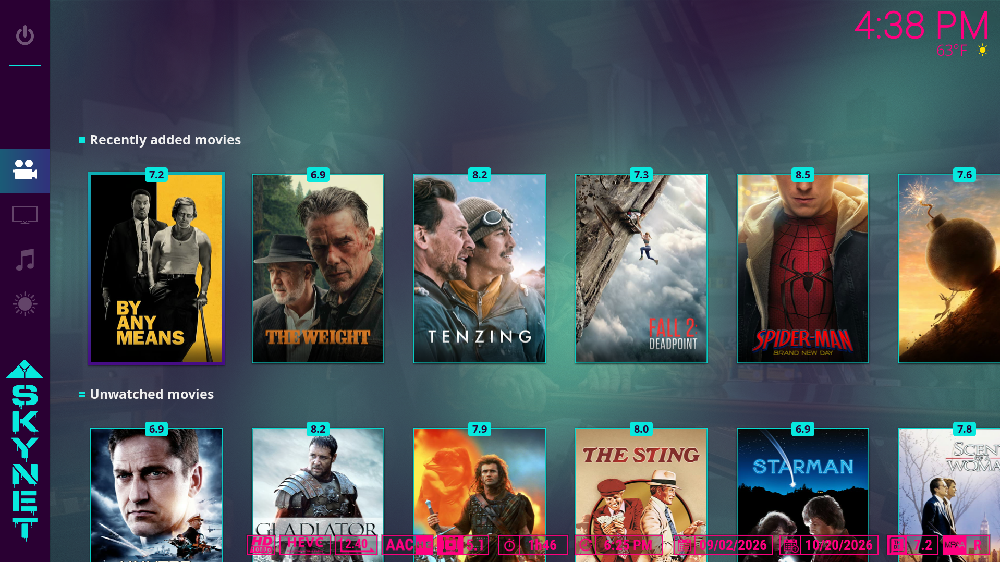
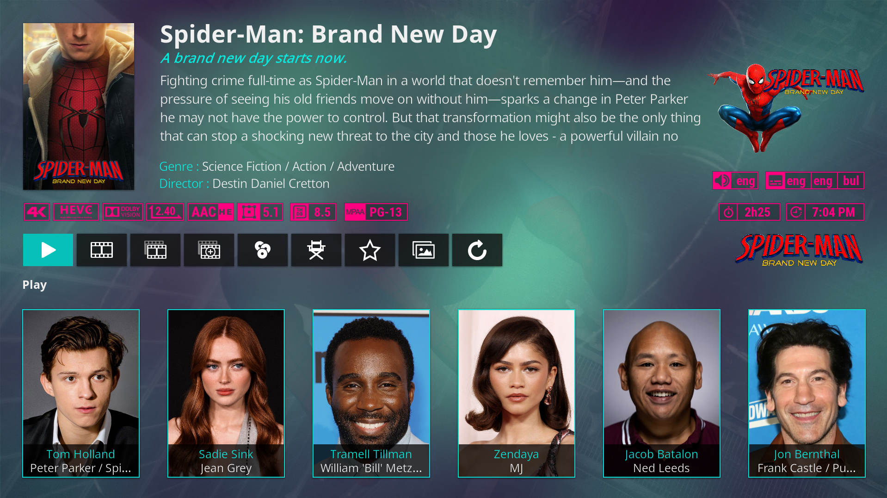
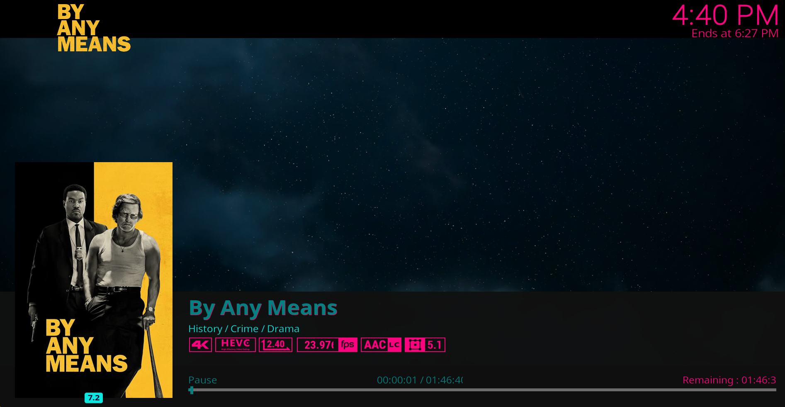
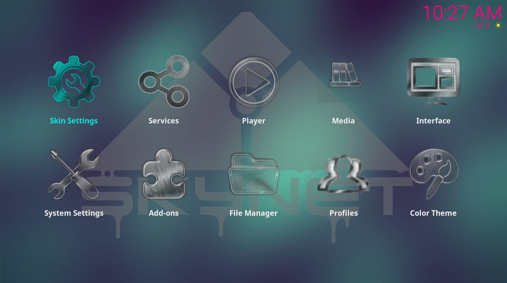
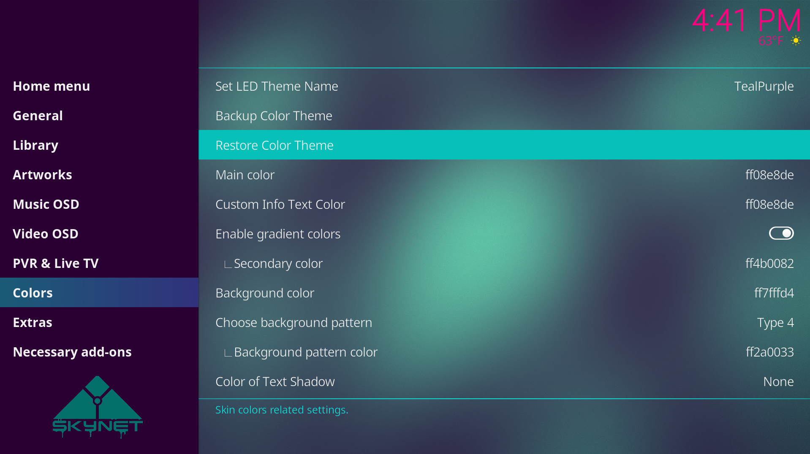
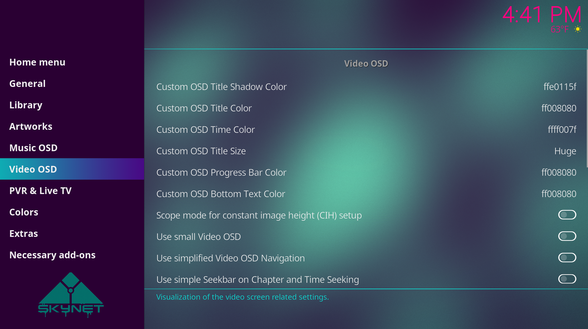
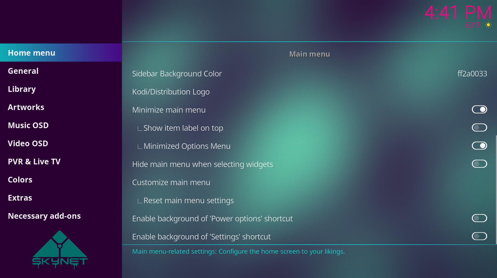
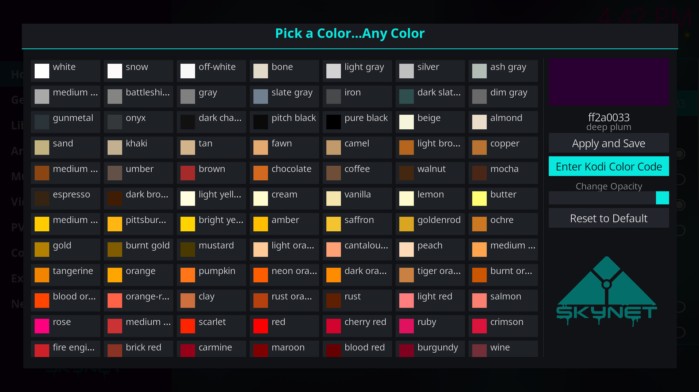

  

# Skynet - a Kodi 22 Piers Skin...with Color

This is a spinoff of the awesome main Estuary Mod V2 skin by B-Jesch. The goal behind this skin was to put color choice freedom viaindependent skin settings in as many new places as possible while tweaking a handful of other visual aspects of the Kodi addon. This skin was first created in Kodi 21 Omega and is still available. This Kodi 22 version includes everything that came in 21 but with additional UI tweaks. All non UI related Piers related stability, functionality and overall improvement fixes that B-Jesch merged into his Estuary Mod V2 skin have been and will continue to be merged into Skynet. The Skynet Colorpicker (script) has been bundled within the skin. No more need to install it seperately. 

The included RGB script and how this optional feature could work for you:

- You need a modern motherboard with RGB headers that is used for LED strip lighting inside a PC case, RGB fans, etc.
- OpenRGB for Windows is needed. Your motherboard may have came with some type of proprietary RGB software...this Kodi skin implementation was only meant for OpenRGB so install it and disable any other RGB apps on your PC
- Set up as many color profiles as you wish in OpenRGB and take specific note of the exact names that you call them. For example in my OpenRGB I have 5 different profiles: Sunset, Grurple, TealPurple, PurPink, and MintMidnight. 
- In Kodi, customize all your colors throughout the numerous color button options within the Estuary Skynet skin settings. Come up with a theme that matches one of the OpenRGB color profiles you made. 
- Go to Skin Settings>Colors>"Set LED Theme Name" and type in the name for this Kodi skin theme but ensure that it is the same exact name as the OpenRGB profile you want it to match with.
- Go to Skin Settings>Colors>"Backup Color Theme" this will create a fresh backup of your current skin-wide color settings. Every color related setting you chose will be backed up INCLUDING the LED theme name setting. 
- On your PC, navigate to wherever you had the Backup skin helper tool dump the zip file for the theme colors in the previous step. Locate the new zip file and manually add the color theme name into the file. for example: Estuary.skynet Skinbackup (2026-07-07 11.19.52).zip --> should become: Estuary.skynet Skinbackup Sunset (2026-07-07 11.19.52).zip
- Follow these same steps to create more Kodi skin color themes, set the corresponding LED theme names, backup the color skin themes, and rename the zip files. 
- Once you are done with all of your color themes all you "should" need to do is go to Skin Settings>Colors>"Restore Color Theme" and choose one of the properly named zip files from your backups. When it is done restoring your color theme just navigate back to the Kodi home screen to allow the skin to refresh. A few seconds later your PC's RGB lights (if connected to your motherboard and working correctly with OpenRGB) should automatically change to the desired color profile. For example if you made a yellow OpenRGB color profile called "Sunset" and you have a yellow/orange/red color theme going in Kodi also backed up to a zip file with "Sunset" in the filename...when you perform the restore your LED lighting should change to yellow while your Kodi colors change to yellow/orange/red. (both are identified by the "Sunset" name).  

Here are the files that have been edited from a UI and/or color customization standpoint that differentiate Skynet from the original Estuary Mod V2:

# Custom XMLs:
- Includes.xml
- Variables.xml
- SkinSettings.xml
- Settings.xml
- VideoOSD.xml
- Home.xml
- includes_Home.xml
- Includes_Animations.xml
- DialogFullScreenInfo.xml
- Includes_Buttons.xml
- script-skinshortcuts.xml
- Custom_1109_TopBarOverlay.xml
- View_54_InfoWall.xml
- Startup.xml
- shortcuts/menus.xml
- Includes_MediaMenu.xml
- script-skin_helper_service-ColorPicker.xml

# Custom scripts/assets:
- scripts/rgb_sync.py
- scripts/colorpicker/default.py
- scripts/colorpicker/resources/lib/ColorPicker.py
- scripts/colorpicker/resources/colors/colors.xml
- scripts/colorpicker/resources/language/resource.language.en_us/strings.po
- scripts/colorpicker/resources/skins/Default/1080i/script-skin_helper_service-ColorPicker.xml
- extras/skynet-logo.png
- extras/skynet-pillar.png
- extras/original-skynet-logo.png
- extras/skynet-yellow-logo.png
- resources/icon.png

  

  

  

  

  

  

  

  

  

